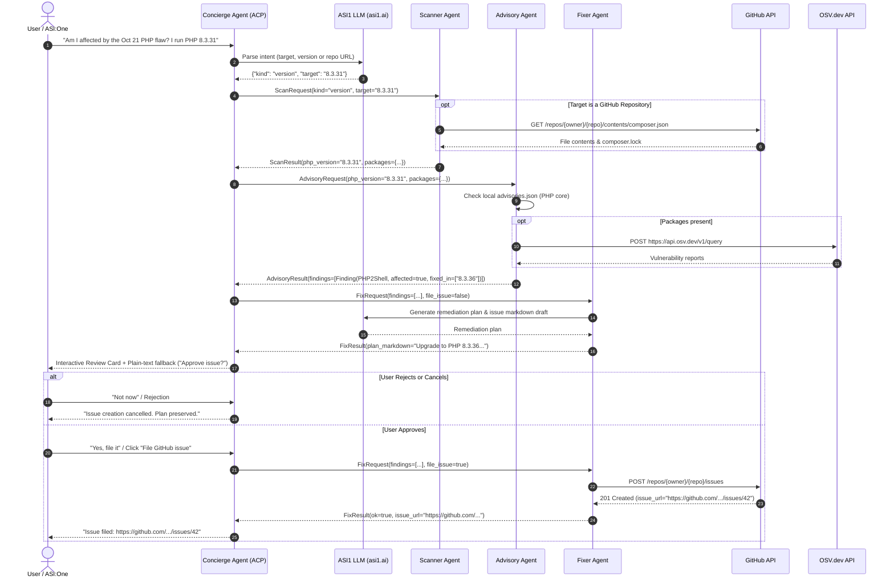

# Dependency Fix Crew


> **Fetch-A-Thon 3.0 Hackathon Submission**  
> **Track:** ASI:One Agent Challenge — *"From Intent to Action"*  
> **Category:** All 4 agents categorized under **Innovation Lab**

---

## 1. Project Introduction

### Problem Statement
When high-severity zero-day or critical vulnerabilities emerge—such as the recent **PHP2Shell** remote code execution flaws ([CVE-2026-109618](https://unit42.paloaltonetworks.com/cve-2026-109618-cve-2026-109619/) and [CVE-2026-109619](https://unit42.paloaltonetworks.com/cve-2026-109618-cve-2026-109619/), patched October 21, 2026)—engineering and security teams face frantic fire drills:
- Determining whether their production runtimes or dependencies are affected across dozens of repositories.
- Interpreting complex version constraints (`composer.json`) and locked versions (`composer.lock`).
- Researching upstream patches and safe upgrade paths.
- Drafting remediation tickets and coordinating fixes without accidentally breaking production.

### Proposed Solution
**Dependency Fix Crew** is an autonomous multi-agent security crew deployed on **Agentverse** and accessible through natural conversation in **ASI:One**. 

A developer simply asks:
> *"Am I affected by the PHP vulnerability from Oct 21? I run PHP 8.3.31"*  
> or provides a GitHub repository URL:  
> *"Audit https://github.com/owner/repo for critical vulnerabilities."*

The crew inspects the target environment, correlates findings with authoritative vulnerability databases, synthesizes a concrete remediation plan via the ASI1 LLM, prompts the developer for explicit approval, and automatically generates an actionable GitHub issue with reproduction and upgrade steps.

### Key Features
- **Conversational Natural Language Interface:** Interacts seamlessly through **ASI:One** using the Agent Chat Protocol (ACP).
- **Zero False-Safety Principle:** If a check fails, the API times out, or data is missing, the crew explicitly reports *"could not verify"*—never claiming a system is safe when it hasn't been proven.
- **Multi-Agent Specialization:** Four distinct uAgents collaborate using strictly typed Pydantic models.
- **Deep Dependency Inspection:** Fetches and parses runtime configurations, `composer.json` requirements, and `composer.lock` hashes via the GitHub REST API.
- **Dual Advisory Intelligence:** Queries [OSV.dev](https://osv.dev/) for open-source package advisories and cross-references a curated database for PHP core runtime CVEs.
- **Human-in-the-Loop Governance:** GitHub issues are **never** created automatically. Remediation plans require explicit user confirmation via text or Interactive Cards before touching external repositories.
- **Interactive Cards with Plain-Text Fallback:** Renders rich interactive review cards in ASI:One with one-click approval buttons, accompanied by full plain-text fallbacks.

### Expected Impact
Reduces vulnerability triage and ticket creation time from hours to seconds during critical security disclosures, while enforcing strict human oversight and zero false-positive safety assurances.

---

## 2. Agent Information

All four agents are registered under the **Innovation Lab** category.

| Agent Name | Category | Primary Responsibility | Agent Address | Agentverse Profile URL |
|---|---|---|---|---|
| **Concierge Agent** | Innovation Lab | Public conversational interface (ACP), ASI1 intent parsing, session state management, Interactive Card rendering, and agent coordination | `agent1qw8nlqj3xt3ejnhhcf2vmpk5d48sx6n2m4ekms2dd6pxzlg0vdpa7v6m9mg` | [View Agentverse Profile](https://agentverse.ai/agents/details/agent1qw8nlqj3xt3ejnhhcf2vmpk5d48sx6n2m4ekms2dd6pxzlg0vdpa7v6m9mg/profile) |
| **Scanner Agent** | Innovation Lab | Inspects PHP versions, parses GitHub repo manifests (`composer.json`, `composer.lock`), and detects dependency trees | `TODO agent1q... (worker agent, assigned on startup)` | `TODO (worker agent profile)` |
| **Advisory Researcher Agent** | Innovation Lab | Cross-references versions with PHP core CVE advisories and queries the OSV.dev API for Composer package vulnerabilities | `TODO agent1q... (worker agent, assigned on startup)` | `TODO (worker agent profile)` |
| **Fixer Agent** | Innovation Lab | Generates remediation plans using ASI1 LLM and creates GitHub issues upon explicit user approval | `TODO agent1q... (worker agent, assigned on startup)` | `TODO (worker agent profile)` |

> *Note on Worker Addresses:* The **Concierge Agent** is the public gateway registered with an active Agentverse Mailbox. The worker agents (Scanner, Advisory, and Fixer) operate inside the multi-agent mesh. Their cryptographic addresses are derived from their respective seeds upon initial boot and can be registered on Agentverse or run locally.

---

## 3. Architecture and Workflow

### Multi-Agent Collaboration Architecture

The architecture enforces strict separation of concerns:
1. **Concierge Agent:** The only agent communicating externally over ACP to ASI:One. It maintains session state and translates user intent using the ASI1 LLM (`https://api.asi1.ai/v1`).
2. **Scanner Agent:** Receives typed `ScanRequest` messages, queries the GitHub REST API for manifest files, and extracts runtime and package versions into a `ScanResult`.
3. **Advisory Researcher Agent:** Receives `AdvisoryRequest` messages, compares version tuples against local and upstream OSV.dev advisories, and returns structured `Finding` objects inside an `AdvisoryResult`.
4. **Fixer Agent:** Receives `FixRequest` messages. In step 1, it crafts an actionable remediation plan using ASI1. Once explicit user approval is granted (`file_issue=True`), it interacts with GitHub's REST API to file the tracking issue.



---

## 4. Complete Setup Guide for Developers

Follow these step-by-step instructions to run the crew locally or connect it to Agentverse.

### Prerequisites
- **Python:** 3.10, 3.11, 3.12, 3.13, or 3.14.
- **Git:** Installed on your system path.
- **Operating System:** macOS, Linux, or Windows (via PowerShell or WSL).
- **Accounts & Tokens:**
  - An [ASI:One](https://asi1.ai/) account with an active API Key.
  - An [Agentverse](https://agentverse.ai/) account (for Mailbox registration and public routing).
  - A [GitHub](https://github.com/) Personal Access Token (classic or fine-grained) with `repo` (issues:write) permission.
  - A test GitHub repository that you own to receive demo issues (e.g., `your-username/test-repo`).

---

### Step 1: Clone Repository & Create Virtual Environment

#### macOS / Linux
```bash
git clone https://github.com/j22k/dependency-fix-crew.git
cd dependency-fix-crew

python3 -m venv .venv
source .venv/bin/activate
```

#### Windows (PowerShell)
```powershell
git clone https://github.com/j22k/dependency-fix-crew.git
cd dependency-fix-crew

python -m venv .venv
.venv\Scripts\Activate.ps1
```

---

### Step 2: Install Dependencies

Install the locked dependencies:
```bash
pip install --upgrade pip
pip install -r requirements.txt
# or via Makefile (macOS/Linux):
make install
```

Verified packages include:
- `uagents==0.25.5` (Fetch.ai multi-agent framework)
- `openai` (used with the ASI1 endpoint `https://api.asi1.ai/v1`)
- `python-dotenv` (secure local configuration)
- `requests` (GitHub and OSV.dev REST integrations)
- `pytest` & `ruff` (testing and linting)

---

### Step 3: Environment Configuration (`.env`)

Create your `.env` file by copying the committed template:
```bash
cp .env.example .env
```

Open `.env` in an editor and configure the variables:

| Variable | Required? | Description & How to Obtain |
|---|---|---|
| `ASI1_API_KEY` | **Yes** | Your API key for the ASI1 LLM. Obtain from [asi1.ai Developer Settings](https://asi1.ai/). |
| `GITHUB_TOKEN` | **Yes** (for live issue filing & private repos) | GitHub Personal Access Token (`ghp_...`). Generate under [GitHub Settings > Developer Settings > Personal access tokens](https://github.com/settings/tokens) with `repo` / `issues:write` scope. |
| `DEMO_REPO` | **Yes** | Target test repository where issues will be filed, formatted as `owner/repo-name` (e.g. `your-github-username/test-repo`). |
| `CONCIERGE_SEED` | **Yes** | A unique cryptographic seed phrase for the Concierge agent (e.g., 12-24 random words). |
| `SCANNER_SEED` | **Yes** | A unique seed phrase for the Scanner agent. |
| `ADVISORY_SEED` | **Yes** | A unique seed phrase for the Advisory agent. |
| `FIXER_SEED` | **Yes** | A unique seed phrase for the Fixer agent. |
| `SCANNER_ADDRESS` | Conditional | The uAgent address of the Scanner (needed in multi-process mode; leave blank initially). |
| `ADVISORY_ADDRESS` | Conditional | The uAgent address of the Advisory agent (needed in multi-process mode; leave blank initially). |
| `FIXER_ADDRESS` | Conditional | The uAgent address of the Fixer agent (needed in multi-process mode; leave blank initially). |
| `USE_MOCKS` | Optional | Set to `1` for single-agent standalone testing; set to `0` for real multi-agent networking. |
| `CARDS` | Optional | Set to `1` (default) to send Interactive Cards with text fallback; `0` for plain text only. |
| `DOWNSTREAM_TIMEOUT_S` | Optional | Maximum seconds Concierge waits for worker agents before timing out (default: `60`). |

> **Security Rule:** Never commit `.env` or agent seed phrases. The `.gitignore` file automatically excludes `.env`.

---

### Step 4: Running the Agents

You can run the system in two modes:

#### Option A: Quickstart Standalone Mode (`USE_MOCKS=1`)
If you want to immediately test the Concierge agent and ASI:One chat without booting all four agents, enable mocks:
1. In `.env`, set:
   ```env
   USE_MOCKS=1
   ```
2. Start the Concierge:
   ```bash
   make run-concierge
   # or: python -m agents.concierge
   ```
The Concierge will simulate worker responses using verified mock data in `agents/mocks.py`.

---

#### Option B: Full Multi-Agent Mode (`USE_MOCKS=0`)
To run all 4 agents communicating asynchronously over uAgents:

1. **Resolve Agent Addresses:**
   Each agent prints its cryptographic address upon booting:
   ```bash
   # Terminal 1: Run Scanner
   make run-scanner
   
   # Terminal 2: Run Advisory
   make run-advisory
   
   # Terminal 3: Run Fixer
   make run-fixer
   ```
   Note the printed addresses (format: `agent1q...`) from each terminal output and add them to your `.env`:
   ```env
   SCANNER_ADDRESS=agent1q...
   ADVISORY_ADDRESS=agent1q...
   FIXER_ADDRESS=agent1q...
   USE_MOCKS=0
   ```

2. **Run the Concierge:**
   ```bash
   # Terminal 4: Run Concierge
   make run-concierge
   ```

---

### Step 5: Connecting to Agentverse & ASI:One Chat

When `make run-concierge` starts, it registers with the Agentverse mailbox and outputs an inspector URL in the terminal:
```
INFO: [dependency-fix-concierge]: Agent registered with address: agent1q...
INFO: [dependency-fix-concierge]: Open Inspector: https://agentverse.ai/inspect/...
```

1. Open the inspector URL in your browser.
2. Sign in to your [Agentverse](https://agentverse.ai) account.
3. Under the **Mailbox** tab, verify that the mailbox status is active.
4. Click **Chat with Agent** to start a session in **ASI:One**.

---

### Step 6: Verifying with the Standalone Fixer Test Script

To verify that the Fixer agent can communicate, synthesize plans, and file GitHub issues independently:
1. Make sure `make run-fixer` is running in one terminal.
2. In a second terminal, execute:
   ```bash
   python test_fixer_demo.py
   ```
3. The script sends a mock vulnerability finding (`PHP2Shell`, `8.3.31`), prints the generated remediation plan, and prompts you to confirm before filing an issue to your `DEMO_REPO`.

---

### Troubleshooting & Common Errors

| Issue | Likely Cause | Solution |
|---|---|---|
| **`OpenAIError` / `401 Unauthorized`** | Invalid or missing `ASI1_API_KEY`. | Verify that your API key is active on [asi1.ai](https://asi1.ai/) and correctly pasted in `.env`. |
| **`GitHub request failed (404)`** | Target repository is private or misspelled. | If the repository is private, make sure `GITHUB_TOKEN` is set with `repo` scope. Ensure `DEMO_REPO` is in `owner/repo` format. |
| **`GitHub request failed (401/403)`** | Expired token or rate limit exceeded. | Check token expiration in GitHub settings. Authenticated requests have a limit of 5,000 requests/hour. |
| **`the Scanner/Advisory/Fixer agent did not respond in time`** | Worker agent not running or address mismatch. | Verify all 4 agent processes are active. Ensure `SCANNER_ADDRESS`, `ADVISORY_ADDRESS`, and `FIXER_ADDRESS` in `.env` match the addresses printed by each agent. |
| **Port already in use (`Errno 48`)** | A previous agent instance is still running. | Check running processes with `lsof -i :8001` or `lsof -i :8004` and terminate lingering processes. |
| **Interactive Cards not rendering** | Card interaction not supported by client. | The system automatically provides full plain-text fallbacks; ensure `CARDS=1` is set if using an ASI:One client with card support. |

---

## 5. Example Walkthrough

### Scenario: Triage and Fix PHP2Shell (CVE-2026-109618 / CVE-2026-109619)

#### 1. User Inquires in ASI:One
> **User:**  
> *"Am I affected by the PHP vulnerability from Oct 21? I run PHP 8.3.31 on my server."*

#### 2. Crew Analysis & Verification
- **Concierge:** Uses ASI1 to parse intent (`kind="version"`, `target="8.3.31"`).
- **Scanner:** Verifies the runtime version string `8.3.31`.
- **Advisory:** Cross-references `data/advisories.json`. Matches `PHP2Shell` (fixed in `8.5.12`, `8.4.27`, `8.3.36`, `8.2.35`). Since `8.3.31 < 8.3.36`, the version is flagged **AFFECTED**.
- **Fixer:** Invokes ASI1 to generate the remediation plan.

#### 3. Review Card Presented to User
The Concierge presents an interactive card in ASI:One with full text fallback:

```markdown
Vulnerability check result:
- Component: php-core 8.3.31
- Status: AFFECTED (CRITICAL)
- Advisory: PHP2Shell (CVE-2026-109618, CVE-2026-109619)
- Fixed in: 8.3.36 (or upgrade to 8.4.27 / 8.5.12)

Remediation Plan:
1. Upgrade the PHP binary / container base image to PHP 8.3.36 or higher.
2. Re-run test suites to verify backward compatibility.
3. Deploy updated runtime to staging and production environments.

Would you like me to file a GitHub issue to track this remediation?
[Button: File GitHub issue]   [Button: Not now]
```

#### 4. Explicit User Approval
The user clicks **File GitHub issue** or responds in chat:
> **User:**  
> *"Yes, please file it."*

#### 5. Issue Created on GitHub
The Fixer agent calls GitHub REST API and returns the link:
> **Concierge:**  
> *"Issue filed: https://github.com/your-username/test-repo/issues/14"*

---

## 6. External Resources

Official documentation and integrations used in this project:

- **Fetch.ai Documentation:** [https://fetch.ai/docs](https://fetch.ai/docs) — Core reference for uAgents, agent registration, and communication protocols.
- **Agentverse Platform:** [https://agentverse.ai/](https://agentverse.ai/) — Agent registry, mailbox service, and agent hosting.
- **ASI:One Platform:** [https://asi1.ai/](https://asi1.ai/) — Conversational chat interface and ASI1 LLM endpoint (`https://api.asi1.ai/v1`).
- **GitHub REST API:** [https://docs.github.com/en/rest](https://docs.github.com/en/rest) — Used by Scanner to read manifests and by Fixer to file remediation issues.
- **OSV.dev Portal:** [https://osv.dev/](https://osv.dev/) — Open Source Vulnerabilities database.
- **OSV API Documentation:** [https://google.github.io/osv.dev/api/](https://google.github.io/osv.dev/api/) — REST query API for automated Composer package vulnerability matching.
- **Fetch.ai Interactive Cards:** [https://innovationlab.fetch.ai/resources/docs/interactive-cards/asi-interactive-cards](https://innovationlab.fetch.ai/resources/docs/interactive-cards/asi-interactive-cards) — Protocol specification for cards in ASI:One.
- **Agent Chat Protocol (ACP):** [https://docs.agentverse.ai/documentation/getting-started/enable-chat-protocol](https://docs.agentverse.ai/documentation/getting-started/enable-chat-protocol) — Standard protocol for chat-enabled agents.

---

## 7. Security, Testing, and Limitations

### Automated Testing
The repository includes comprehensive unit and integration tests. Run them using:
```bash
make test
# or: python -m pytest tests
```
*Current test suite: 17 passed tests covering advisory matching, version parsing, LLM JSON extraction, and scanner error recovery.*

To run lint checks:
```bash
make lint
# or: python -m ruff check .
```

### Security & Operational Safeguards
1. **Zero False-Safety Guarantee:** When network calls fail or advisory lookups return errors, the crew explicitly reports *"could not verify"* rather than claiming the system is safe.
2. **Mandatory Human Approval:** No issue is ever created without explicit confirmation in the chat session (`file_issue=True`).
3. **Credential Protection:** Secrets are never hardcoded. Each agent uses a distinct cryptographic seed loaded strictly from the environment.
4. **Input Sanitization & Retries:** GitHub API calls include a retry policy and strict 10-second timeouts. Markdown fences and JSON inputs from LLM responses are parsed with deterministic fallback heuristics.

### Known Limitations & Roadmap
- **PHP Core Advisory Coverage:** The PHP core runtime advisory database is currently seeded from curated disclosures in `data/advisories.json` (e.g. PHP2Shell). Future iterations will integrate automated scraping of official PHP security announcements.
- **Composer Package Scope:** Package checks query OSV.dev; private, non-packagist repositories without public CVE references cannot be checked.
- **Payment Protocol (Planned):** Per-scan micropayments via Fetch.ai Payment Protocol are planned for a future release (R11 roadmap item) and are not currently active in the codebase.

---

## 8. Contributors & License

### The Crew
Built by **Dependency Fix Crew** for Fetch-A-Thon 3.0:
- **Junaid (Dev A):** Concierge Agent, ACP integration, ASI1 intent parsing, Interactive Cards.
- **Musthafa (Dev B):** Scanner Agent, Advisory Researcher Agent, OSV.dev & advisory data.
- **Falahi (Dev C):** Fixer Agent, GitHub API issue filing, testing scripts, and documentation.

### Repository
- **GitHub Repository:** [https://github.com/j22k/dependency-fix-crew](https://github.com/j22k/dependency-fix-crew)

### License
This project is open-source software submitted as part of the **Fetch-A-Thon 3.0 Hackathon**.
